# Evidence AI — Digital Evidence Intelligence & Forensic Reconstruction Platform

[](LICENSE)
[](https://fastapi.tiangolo.com)
[](https://react.dev)
[](https://www.typescriptlang.org)
[](https://vitejs.dev)
[](https://ollama.com)
[](https://pytorch.org)

Evidence AI is a privacy-first, local digital evidence intelligence and incident reconstruction platform. It ingests multi-modal digital evidence (screenshots, chat exports, audio voicemails, banking statements, and legal agreements), cryptographically fingerprints every artifact using SHA-256, screens media for synthetic/deepfake manipulation, extracts textual and semantic visual observations, disambiguates entities, deterministically reconstructs chronological event timelines, generates interactive clarification questionnaires, and compiles court-admissible forensic incident reports.

---

## Table of Contents

- [1. Project Introduction](#1-project-introduction)
  - [Problem Statement](#problem-statement)
  - [Target Users](#target-users)
  - [Main Objectives](#main-objectives)
  - [Capabilities & Limitations Summary](#capabilities--limitations-summary)
- [2. Core Features](#2-core-features)
- [3. Complete Technology Stack](#3-complete-technology-stack)
- [4. AI Model Reference Table](#4-ai-model-reference-table)
- [5. System Architecture](#5-system-architecture)
  - [Architecture Diagram](#architecture-diagram)
  - [Storage and Intermediate Artifacts](#storage-and-intermediate-artifacts)
- [6. Pipeline Execution & Stage Lifecycle](#6-pipeline-execution--stage-lifecycle)
  - [The 18 Pipeline Stages](#the-18-pipeline-stages)
  - [Job States and State Machine](#job-states-and-state-machine)
  - [Error Handling and Partial Failure Recovery](#error-handling-and-partial-failure-recovery)
- [7. Installation and Setup (Windows PowerShell)](#7-installation-and-setup-windows-powershell)
- [8. Running the Application](#8-running-the-application)
- [9. Demo Usage Guide](#9-demo-usage-guide)
- [10. API Documentation](#10-api-documentation)
- [11. Hardware Requirements & Resource Management](#11-hardware-requirements--resource-management)
- [12. Testing & Verification](#12-testing--verification)
- [13. Known Limitations](#13-known-limitations)
- [14. Future Scope & Roadmap](#14-future-scope--roadmap)
- [15. Project Structure](#15-project-structure)
- [16. Project Status](#16-project-status)

---

## 1. Project Introduction

### Problem Statement

Victims of financial fraud, cyber-extortion, harassment, and corporate coercion face complex evidentiary hurdles. Evidence is typically fragmented across unstructured channels: WhatsApp/Signal screenshots, recorded telephone intercepts, PDF banking ledgers, and email threads. Traditional tools either compromise privacy by uploading sensitive files to cloud LLM APIs, lack forensic validation gates, or fail to reconcile contradictions between conflicting evidence.

### Target Users

- **Legal Aid Advocates & Forensic Investigators**: Rapidly assembling chronological timelines, grounding facts with verbatim citations, and preparing structured case dossiers.
- **Cybercrime & Fraud Analysts**: Evaluating multi-stage extortion chains, detecting deepfake audio calls, and identifying phishing portals.
- **Victim Support Advocates**: Ingesting raw testimony and screenshots in an accessible, calm, non-intimidating interface with quick-exit safety protections.

### Main Objectives

1. **Local-First Privacy**: Never leak private evidence or customer identifiers to third-party cloud APIs; run all models locally.
2. **Forensic Traceability**: Maintain strict cryptographic provenance (SHA-256 hashing at ingestion time, immutable audit logs).
3. **Rigorous Authenticity Policy**: Screen media for AI generation and enforce configurable review modes (`Strict Review` vs `Development`).
4. **Multi-Modal Evidence Fusion**: Combine OCR text, audio transcripts, document tables, and VLM visual observations into a coherent narrative without hallucinating unobserved facts.
5. **Interactive Clarification**: Generate targeted questions that target factual unknowns and incorporate witness testimony directly into the final report.

### Capabilities & Limitations Summary

- **Capabilities**: Multi-file ingestion, SHA-256 fingerprinting, C2PA provenance parsing, neural deepfake/synthetic detection for image/audio, multi-line table parsing, timeline builder, entity disambiguation via RapidFuzz, clarification quiz, and forensic PDF/HTML report compilation.
- **Limitations**: Detection models are probabilistic screening gates and cannot provide legal proof of authenticity. Small local LLMs require strict quality-gate guardrails. Video evidence requires pre-extraction to frames/audio.

---

## 2. Core Features

- **Multi-Format Evidence Intake**: Drag-and-drop support for images (`.png`, `.jpg`, `.jpeg`, `.webp`), audio (`.mp3`, `.wav`, `.m4a`, `.ogg`), and documents (`.txt`, `.pdf`, `.docx`, `.eml`, `.csv`, `.json`).
- **Cryptographic Fingerprinting (SHA-256)**: Computes deterministic SHA-256 hashes on the raw incoming byte stream prior to persisting files on disk.
- **Image Authenticity Screening**: Sentry ConvNeXt Small checks for synthetic textures, diffusion artifacts, and GAN generation signatures.
- **Audio Deepfake Detection**: PellaV2 evaluates acoustic frames across 4.0-second sliding windows for neural vocoder and voice cloning traces.
- **Evidence Policy Enforcement**:
  - `Strict Review`: Automatically quarantines confirmed synthetic items (`EXCLUDED_PENDING_REVIEW`) and stops substantive analysis if zero eligible files remain.
  - `Development Mode`: Retains synthetic files for analysis while marking all findings with explicit forensic warning badges.
  - Investigator overrides (`EXCLUDED_BY_INVESTIGATOR` or `RESTORED_BY_INVESTIGATOR`) take precedence.
- **OCR & Speech Transcription**: High-accuracy local text extraction using PaddleOCR (PP-OCRv6_small) and Faster-Whisper (Whisper Small via CTranslate2).
- **Semantic Image Understanding (Qwen3-VL)**: Extracts visual content types (meme, chat, social post, document), UI elements, meme indicators, and context missed by plain OCR.
- **Entity Extraction & Disambiguation**: GLiNER Small zero-shot extraction coupled with RapidFuzz fuzzy alias clustering.
- **Event Timeline Reconstruction**: Extracts structured event candidates, normalizes timestamps, and builds a deterministic chronology.
- **Contradiction Analysis**: Cross-analyzes multi-evidence discrepancies and flag temporal or factual contradictions.
- **Contextual Clarification Engine**: Identifies unresolved ambiguities and pauses the pipeline (`WAITING_FOR_USER`) to present a multi-choice clarification questionnaire.
- **Forensic Report Generation**: Produces Output A (Brief Summary, 100–180 words) and Output B (Detailed Forensic Narrative, 200–350 words) with source-linked citations and technical appendices.
- **User Authentication & Session Persistence**: Secure local session cookies with PBKDF2-HMAC-SHA256 password hashing and isolated case ownership.

---

## 3. Complete Technology Stack

### Frontend

| Technology | Version | Purpose |
| :--- | :--- | :--- |
| **React** | `^18.3.1` | Single-page user interface component framework |
| **TypeScript** | `^5.6.3` | Type-safe application architecture |
| **Vite** | `^5.4.11` | Build tool and local development proxy |
| **Tailwind CSS** | `^3.4.15` | Modern utility-first styling with accessible light palette |
| **React Router** | `^6.28.0` | Client-side routing (`/cases`, `/cases/:id`, `/vault`, `/login`, `/guide`) |
| **Lucide React** | `^0.460.0` | Accessible forensic and investigative interface iconography |
| **React Dropzone** | `^14.3.5` | Drag-and-drop multi-file evidence upload handling |

### Backend

| Technology | Version | Purpose |
| :--- | :--- | :--- |
| **Python** | `3.11+` | Core backend runtime |
| **FastAPI** | `^0.110.0` | High-performance asynchronous REST API framework |
| **Uvicorn** | `^0.28.0` | ASGI web server runtime |
| **Pydantic** | `^2.6.4` | Strict schema validation, settings management, and serialization |
| **SQLAlchemy** | `^2.0.28` | Relational ORM mapping for SQLite / PostgreSQL |
| **SQLite3** | `3.40+` | Zero-configuration local database engine with WAL support |

### AI, Machine Learning & NLP

| Technology | Version | Purpose |
| :--- | :--- | :--- |
| **PaddlePaddle / PaddleOCR** | `3.3.1` / `3.7.0` | Text detection and recognition (PP-OCRv6_small) |
| **Faster-Whisper** | `1.2.1` | Optimized ASR speech transcription via CTranslate2 |
| **CTranslate2** | `4.9.0` | Fast inference runtime for Whisper models on CPU/GPU |
| **PyTorch / TorchAudio** | `^2.0.0` | Deep learning framework powering Sentry and PellaV2 |
| **GLiNER** | `^0.2.30` | Zero-shot named entity recognition (`urchade/gliner_small-v2.1`) |
| **RapidFuzz** | `^3.14.0` | C++ Levenshtein distance & fuzzy string matching for alias clustering |
| **Ollama** | `0.6+` | Local daemon serving Qwen3-VL and Qwen2.5/3 language models |
| **PyCryptodome** | `^3.20.0` | Cryptographic SHA-256 and checksum verification |
| **python-docx / pypdf** | `^1.1.0` / `^4.0.0` | Document and PDF parsing engines |

---

## 4. AI Model Reference Table

| Model Name | Exact Configured Checkpoint / Identifier | Purpose | Model Source & Provider | Pipeline Stage | Hardware & Runtime Requirements | Important Limitations |
| :--- | :--- | :--- | :--- | :--- | :--- | :--- |
| **PaddleOCR PP-OCRv6** | `PP-OCRv6_small` / `PP-OCRv4` (`paddleocr==3.7.0`) | Text detection & optical character recognition from images | [PaddlePaddle/PaddleOCR](https://github.com/PaddlePaddle/PaddleOCR) | Stage 4: `EXTRACT_CONTENT` | CPU or CUDA GPU; ~200 MB memory | Optimized for horizontal text; may struggle on low-res cursive or heavy JPEG artifacting. |
| **Faster-Whisper Small** | `Systran/faster-whisper-small` via CTranslate2 | Speech-to-text transcription with timestamps | [SYSTRAN/faster-whisper](https://github.com/SYSTRAN/faster-whisper) | Stage 4: `EXTRACT_CONTENT` | CPU or CUDA GPU; ~1.0 GB RAM/VRAM; float16/int8 | Sensitive to loud background noise or overlapping speakers. |
| **Sentry ConvNeXt Small** | `sentry-convnext-small` (`InfImagine/Sentry_image_models`, `epoch_5.pth`) | AI-generated and diffusion artifact detection in images | [InfImagine/Sentry_image_models](https://huggingface.co/InfImagine/Sentry_image_models) | Stage 2: `ASSESS_MEDIA_AUTHENTICITY` | PyTorch on CPU/GPU; ~250 MB weights | Texture-level classifier; does not evaluate semantic plausibility of chat dialogue. |
| **PellaV2 Synthetic Speech Detector** | `pellav2-audio-deepfake-detector` (W2V-BERT 2.0 backbone) | Audio deepfake and neural vocoder speech detection | [Sadanie/pellav2](https://huggingface.co/Sadanie/pellav2-audio-deepfake-detector) | Stage 2: `ASSESS_MEDIA_AUTHENTICITY` | PyTorch on CPU/GPU; ~1.2 GB RAM/VRAM | Multi-window sliding check; detects vocoders, does not verify caller legal identity. |
| **Qwen3-VL 4B Instruct** | `qwen3-vl:4b-instruct` | Multimodal visual semantic analysis & UI interpretation | [Qwen/Qwen3-VL on Ollama](https://ollama.com/library/qwen3-vl) | Stage 6: `ANALYZE_IMAGES_SEMANTICALLY` | Local Ollama daemon; NVIDIA CUDA (6 GB VRAM with 1024px dynamic edge scaling) | Requires Ollama running; cannot legally certify real identity or intent. |
| **GLiNER Small v2.1** | `urchade/gliner_small-v2.1` | Zero-shot Named Entity Recognition (Persons, Orgs, Amounts, Dates) | [urchade/gliner_small-v2.1](https://huggingface.co/urchade/gliner_small-v2.1) | Stage 7: `EXTRACT_ENTITIES` | PyTorch CPU/GPU; ~600 MB RAM | Depends on OCR text quality; character drops in OCR can cause missed entity spans. |
| **RapidFuzz Disambiguator** | `RapidFuzz` (Levenshtein & Token Sort Ratio) | Fuzzy alias matching & candidate entity deduplication | [rapidfuzz/RapidFuzz](https://github.com/rapidfuzz/RapidFuzz) | Stage 8: `MATCH_ENTITIES` | C++ execution on CPU; <10 ms | Heuristic string distance; calibrated with 75–85% confidence thresholds. |
| **Qwen Language Model** | `qwen2.5:3b` / `qwen3` via Ollama | Multi-line bank parsing, event extraction, and case reasoning | [Qwen/Qwen2.5 on Ollama](https://ollama.com/library/qwen2.5) | Stage 9, 10, 13, 14, 17 | Local Ollama daemon; ~2.2 GB VRAM | Small 3B parameter model; requires strict grounding quality gates to prevent hallucination. |

---

## 5. System Architecture

### Architecture Diagram

```mermaid
flowchart TD
    subgraph Client ["Frontend Layer (React + TypeScript + Vite)"]
        UI["React SPA (Port 5173)"]
        AuthMe["Session Auth Provider"]
        CaseView["Case Management & Vault"]
        StageViewer["18-Stage Progress Tracker"]
        QuizUI["Contextual Clarification Quiz"]
        ReportUI["Forensic Report Viewer"]
    end

    subgraph API ["API & Service Layer (FastAPI + Uvicorn)"]
        Router["FastAPI Routes (/api/*)"]
        AuthService["PBKDF2 Auth & Session Guard"]
        Orchestrator["Analysis Orchestrator (Single-Worker Lock)"]
    end

    subgraph Storage ["Storage & Persistence"]
        DB[("SQLite (evidence_ai.db)")]
        DiskStorage["Untouched Files (storage/originals/)"]
        ModelCache["SHA-256 Vision & Authenticity Cache"]
    end

    subgraph Engines ["Local AI & ML Inference"]
        Sentry["Sentry ConvNeXt Small (Image Authenticity)"]
        Pella["PellaV2 W2V-BERT (Audio Deepfake)"]
        OCR["PaddleOCR PP-OCRv6_small"]
        ASR["Faster-Whisper Small (CTranslate2)"]
        GLiNER["GLiNER Small v2.1 (Named Entities)"]
        RF["RapidFuzz (Entity Disambiguation)"]
        OllamaVision["Qwen3-VL 4B Instruct (Ollama :11434)"]
        OllamaText["Qwen2.5 3B (Event Extraction & Reasoning)"]
    end

    UI -->|HTTP / JSON / Cookies| Router
    Router --> AuthService
    AuthService --> DB
    Router --> Orchestrator
    Router --> DiskStorage

    Orchestrator -->|Stage 1: Fingerprint| DiskStorage
    Orchestrator -->|Stage 2: Screening| Sentry
    Orchestrator -->|Stage 2: Screening| Pella
    Orchestrator -->|Stage 4: Extraction| OCR
    Orchestrator -->|Stage 4: Extraction| ASR
    Orchestrator -->|Stage 6: Vision| OllamaVision
    Orchestrator -->|Stage 7-8: Entities| GLiNER
    Orchestrator -->|Stage 7-8: Matching| RF
    Orchestrator -->|Stage 9-10: Reasoning| OllamaText
    Orchestrator -->|Stage 14: Quiz| QuizUI
    Orchestrator -->|Stage 17: Final Report| ReportUI
    Orchestrator --> DB
    Orchestrator --> ModelCache
```



### Storage and Intermediate Artifacts

- **Original Evidence**: Stored unmodified at `storage/originals/{case_id}/{uuid}.{ext}`. Filenames are assigned random UUIDs to avoid path traversal; original names are preserved in SQLite.
- **Relational Tables**:
  - `users`, `user_sessions`: Authentication and ownership.
  - `cases`, `evidence`: Evidence records, SHA-256 hashes, review status, authenticity scores, and extraction metadata.
  - `analysis_jobs`, `analysis_job_stages`: Durable pipeline states, order indices, progress timestamps, and JSON details.
  - `entity_matches`, `events`, `event_contradictions`: Intermediate NLP and timeline artifacts.
  - `clarification_questions`, `user_answers`: Interactive quiz records.
  - `reconstructed_reports`, `mvp_analyses`: Final reports and HTML previews.
- **Model Caches**: Persistent JSON files in `models_cache/` keyed by `sha256::model_name::pipeline_version` prevent redundant GPU inference on unchanged files.

---

## 6. Pipeline Execution & Stage Lifecycle

### The 18 Pipeline Stages

1. `VALIDATE_EVIDENCE`: Verifies cryptographic SHA-256 integrity, MIME types, and physical file existence.
2. `ASSESS_MEDIA_AUTHENTICITY`: Runs Sentry ConvNeXt Small (images) and PellaV2 (audio) to evaluate synthetic artifacts and C2PA provenance.
3. `APPLY_EVIDENCE_POLICY`: Applies `Strict Review` or `Development` policy. Quarantines synthetic files; halts with `NO_ELIGIBLE_EVIDENCE` if zero files qualify under strict policy.
4. `EXTRACT_CONTENT`: Executes PaddleOCR, Faster-Whisper, or document text parsers with SHA-256 smart caching.
5. `NORMALIZE_CONTENT`: Standardizes character encodings, cleans whitespace, and normalizes date formats.
6. `ANALYZE_IMAGES_SEMANTICALLY`: Runs Qwen3-VL 4B Instruct via Ollama to produce visual scene descriptions, meme tags, and interface context.
7. `EXTRACT_ENTITIES`: Runs GLiNER Small v2.1 to identify persons, organizations, locations, monetary amounts, and dates.
8. `MATCH_ENTITIES`: Applies RapidFuzz token sort matching to resolve aliases, normalize variants, and link candidates.
9. `UNDERSTAND_CASE`: Synthesizes evidence-backed facts, assigns domain (`banking_fraud`, `corporate_coercion`, `social_media_harassment`, `general_investigation`), and drafts citations.
10. `EXTRACT_EVENTS`: Parses messages, bank transaction tables, and calls into discrete timestamped event candidates.
11. `BUILD_TIMELINE`: Constructs a deterministic chronological event sequence, separating scheduled events from unscheduled records.
12. `IDENTIFY_UNCERTAINTIES`: Cross-examines evidence for contradictions, unanchored timestamps, and disputed assertions.
13. `GENERATE_PRELIMINARY_STORY`: Compiles Output A (Brief Summary, 100–180 words) and Output B (Preliminary Narrative, 150–250 words) with strict word-count quality gates.
14. `GENERATE_CONTEXTUAL_QUIZ`: Produces 3–5 high-value clarification questions targeting specific case unknowns.
15. `AWAIT_USER_ANSWERS`: **Pauses pipeline** (`WAITING_FOR_USER`) awaiting user/investigator clarification answers.
16. `INCORPORATE_CLARIFICATIONS`: Resumes pipeline, weighting user answers into the factual context.
17. `GENERATE_FINAL_REPORT`: Compiles the 200–350 word forensic narrative, timeline tables, and technical audit appendix.
18. `COMPLETE`: All pipeline stages verified, finalized, and marked complete.

### Job States and State Machine

```
[ PENDING ] ──> [ RUNNING ] ──> [ WAITING_FOR_USER ] ──> [ RUNNING ] ──> [ COMPLETED ]
                     │                     │
                     ├──> [ FAILED ]       └──> (investigator submits answers)
                     │
                     └──> [ NO_ELIGIBLE_EVIDENCE ] (Strict policy gate: all files synthetic)
```

### Error Handling and Partial Failure Recovery

- **Sequential GPU Lock**: `_INFERENCE_LOCK` and `_VISION_GPU_LOCK` enforce single-worker execution to protect laptops with 6 GB VRAM from out-of-memory crashes.
- **Graceful Partial Fallback**: If an image fails in Qwen3-VL (e.g. timeout or decode error), its error is logged, marked in `extraction_metadata`, and downstream reasoning proceeds using PaddleOCR verbatim text.
- **Automatic Resume**: When a user submits quiz answers, `resume_analysis_after_quiz_submission()` transitions the job from `AWAIT_USER_ANSWERS` directly to `INCORPORATE_CLARIFICATIONS` without repeating earlier OCR or authenticity checks.

---

## 7. Installation and Setup (Windows PowerShell)

### Prerequisites

- **OS**: Windows 10/11 (64-bit)
- **Python**: Version `3.11.x`
- **Node.js**: Version `18.x` or `20.x` LTS
- **Ollama**: Installed from [ollama.com](https://ollama.com)
- **NVIDIA GPU**: (Recommended) RTX 3050/4050 6 GB VRAM or higher with CUDA support

### Step-by-Step Installation

```powershell
# 1. Clone the repository
git clone https://github.com/piyush231311/EvidenceAI_CodeY.git
cd EvidenceAI_CodeY

# 2. Create and activate a Python virtual environment
python -m venv .venv
.\.venv\Scripts\Activate.ps1

# 3. Upgrade pip and install Python dependencies
python -m pip install --upgrade pip
pip install -r requirements.txt

# 4. Install frontend npm dependencies
cd frontend
npm install
cd ..

# 5. Create local environment configuration
Copy-Item .env.example .env

# 6. Pull required Ollama models (in a separate terminal or service)
ollama serve
ollama pull qwen3-vl:4b-instruct
ollama pull qwen2.5:3b

# 7. Seed the development demo user
python scripts/seed_demo_user.py
```

---

## 8. Running the Application

### 1. Start Ollama Daemon

In Terminal 1:
```powershell
ollama serve
```

### 2. Start the FastAPI Backend

In Terminal 2 (with `.venv` activated):
```powershell
.\.venv\Scripts\Activate.ps1
uvicorn backend.main:app --host 127.0.0.1 --port 8000 --reload
```
- API Base URL: `http://127.0.0.1:8000`
- Interactive OpenAPI Docs: `http://127.0.0.1:8000/docs`
- Health Check: `http://127.0.0.1:8000/api/health`

### 3. Start the Vite Frontend Dev Server

In Terminal 3:
```powershell
cd frontend
npm run dev
```
- Web Application: `http://localhost:5173`

---

## 9. Demo Usage Guide

> [!WARNING]
> **Forensic Notice**: The built-in demo credentials (`demo@evidenceai.local`) are provided strictly for local development and testing. Never enable demo accounts on servers holding real private evidence.

1. **Log In**: Open `http://localhost:5173/login`. Click **"Fill Demo Credentials"** (`demo@evidenceai.local` / `DemoUser123!`) and click **Sign In**.
2. **Create a Case**: From the Cases dashboard, click **"New Case"** to generate a new case UUID.
3. **Upload Evidence**: Drag and drop test files (e.g., from `tests/data/` or `DATA SET/`).
4. **Choose Evidence Policy**:
   - Select **Strict Review** to enforce synthetic media quarantine.
   - Select **Development** to analyze all files with forensic disclaimers.
5. **Run One-Click Analysis**: Click **"Analyze Case"**.
6. **Monitor Live Stages**: Watch the 18 stages execute in real-time with visual indicators.
7. **Review Preliminary Story**: Inspect Output A (Brief Summary) and Output B (Preliminary Narrative) once Stage 13 completes.
8. **Answer Clarification Quiz**: At Stage 15 (`Awaiting Testimony`), select answers to the case unknowns and click **"Submit Testimony"**.
9. **Inspect Final Report**: View the finalized narrative, chronological timeline, entity cards, and technical appendix.

---

## 10. API Documentation

| Method | Endpoint | Description |
| :--- | :--- | :--- |
| `POST` | `/api/auth/login` | Authenticate user credentials and establish session cookie |
| `POST` | `/api/auth/logout` | Terminate session and clear cookie |
| `GET` | `/api/auth/me` | Fetch authenticated user profile |
| `GET` | `/api/auth/demo-credentials`| Retrieve development demo credentials |
| `GET` | `/api/cases` | List all cases owned by the current user |
| `POST` | `/api/cases` | Create a new case container |
| `DELETE` | `/api/cases/{case_id}` | Delete a case and cascade delete all associated evidence |
| `POST` | `/api/cases/{case_id}/evidence` | Ingest multiple evidence files with SHA-256 fingerprinting |
| `GET` | `/api/cases/{case_id}/evidence` | List all evidence items for a case |
| `GET` | `/api/evidence/{evidence_id}/file`| Stream original untouched evidence file from disk |
| `POST` | `/api/cases/{case_id}/analyze` | Launch the 18-stage analysis orchestrator job |
| `GET` | `/api/cases/{case_id}/analysis/active-job` | Retrieve active or most recent job for a case |
| `GET` | `/api/analysis/jobs/{job_id}/stages` | Retrieve status of all 18 individual stages |
| `GET` | `/api/analysis/jobs/{job_id}/quiz` | Retrieve active clarification quiz questions |
| `POST` | `/api/analysis/jobs/{job_id}/quiz/submit` | Submit witness clarification answers and resume pipeline |
| `GET` | `/api/cases/{case_id}/report` | Retrieve JSON forensic incident report |
| `GET` | `/api/cases/{case_id}/report/html` | Render printable, standalone HTML forensic report |
| `GET` | `/api/health` | Service health status check |

Interactive Swagger documentation is available at [http://127.0.0.1:8000/docs](http://127.0.0.1:8000/docs).

---

## 11. Hardware Requirements & Resource Management

### Development Environment Baseline

- **OS**: Windows 11 Home (x64)
- **CPU**: 13th Gen Intel Core i5 / AMD Ryzen 5 or better
- **RAM**: 16 GB DDR5
- **GPU**: NVIDIA GeForce RTX 4050 Laptop GPU (6.0 GB VRAM)
- **CUDA Runtime**: Version 12.x

### Resource Management Safeguards

- **Sequential Model Locks**: `_INFERENCE_LOCK` and `_VISION_GPU_LOCK` ensure that heavy models (PaddleOCR, Whisper, Sentry, PellaV2, Qwen3-VL, and Qwen2.5) never execute simultaneously on a single GPU.
- **Dynamic Image Edge Bounding**: `_encode_image_for_vlm` in `src/extraction/semantic_vision.py` dynamically resizes high-resolution screenshots to a maximum edge of 1024px in memory, preventing CUDA out-of-memory errors on 6 GB VRAM cards.
- **Model Unloading**: `unload_ollama_model()` allows explicit eviction of vision models from VRAM when switching between vision and text reasoning passes.

---

## 12. Testing & Verification

### Running the Test Suite

```powershell
# Run authentication and ownership tests
pytest tests/test_auth_and_ownership.py -v

# Run media authenticity and policy contract tests
pytest tests/test_media_authenticity.py tests/test_authenticity_contract_and_policy.py -v

# Run case understanding and route tests
pytest tests/test_case_understanding_route.py -v

# Run entity matching regression tests
pytest tests/test_entity_matching_regression.py -v
```

### Frontend Build Verification

```powershell
cd frontend
npm run build
```

*Note on Testing Modes*: Unit test suites utilize synthetic fixtures located in `tests/data/`. Live Ollama inference tests require `ollama serve` running with `qwen3-vl:4b-instruct` and `qwen2.5:3b` installed.

---

## 13. Known Limitations

1. **Probabilistic Authenticity Detection**: Sentry ConvNeXt and PellaV2 output probabilistic anomaly scores based on statistical frequency and vocoder artifacts. They cannot provide definitive legal proof that a file was or was not AI-generated.
2. **OCR & Transcription Artifacts**: PaddleOCR and Faster-Whisper can occasionally misread degraded text or noisy audio. Downstream reasoning should always provide verbatim quotes for investigator verification.
3. **Local VLM Memory Constraints**: On 6 GB VRAM GPUs, Qwen3-VL requires bounded image resolution (1024px max edge). Processing large batches of images runs sequentially to prevent CUDA out-of-memory errors.
4. **Ollama Server Dependency**: Semantic vision analysis requires the external Ollama background service. If Ollama is offline or uninstalled, the orchestrator logs the failure and gracefully falls back to OCR-based reasoning.
5. **Human Review Requirement**: All AI-generated narratives, timeline reconstructions, and clarification questions are investigative aids that require verification by human forensic professionals.

---

## 14. Future Scope & Roadmap

- **Direct Video Processing**: Automatic keyframe extraction and audio separation for CCTV and screen-recording video evidence.
- **Expanded Deepfake Ensembles**: Integration of frequency-domain spatial detectors and face-swap artifacts models.
- **Knowledge Graph Visualization**: Interactive graph exploring cross-case entity relationships and recurring fraudulent UPI handles.
- **RAG & Cross-Case Evidence Search**: Vector search over archived case transcripts using local embeddings.
- **Multilingual Support**: Hindi, Kannada, Tamil, and regional Indian language support for transcription and NER.
- **Formal Chain-of-Custody Export**: Cryptographically signed PDF dossiers compliant with court admissibility standards.

---

## 15. Project Structure

```text
EvidenceAI_CodeY/
├── .env.example                       # Environment configuration template
├── .gitignore                         # Comprehensive exclusion rules
├── README.md                          # Platform documentation
├── requirements.txt                   # Backend Python dependencies
├── package.json                       # Root helper scripts
├── app.py                             # Standalone Streamlit test runner
│
├── backend/                           # FastAPI backend service
│   ├── __init__.py
│   ├── auth.py                        # PBKDF2 authentication & sessions
│   ├── authenticity.py                # Pluggable authenticity entry points
│   ├── db.py                          # SQLAlchemy engine & SQLite configuration
│   ├── main.py                        # FastAPI application entry point & CORS
│   ├── models.py                      # SQLAlchemy models & Pydantic schemas
│   ├── routes.py                      # REST API endpoint route handlers
│   └── services/
│       └── analysis_orchestrator.py   # 18-stage analysis workflow engine
│
├── frontend/                          # React + TypeScript + Vite frontend
│   ├── package.json
│   ├── tsconfig.json
│   ├── vite.config.js
│   ├── index.html
│   └── src/
│       ├── App.tsx                    # Main router & layout root
│       ├── main.tsx                   # React DOM entry point
│       ├── pages/                     # CaseDetails, Cases, Vault, Login, Guide
│       ├── components/                # Modals, buttons, navbar, sidebar
│       ├── context/                   # AuthContext, AppContext
│       ├── services/                  # Frontend API client
│       └── types/                     # TypeScript interfaces
│
├── src/                               # AI/ML core libraries
│   ├── detection/
│   │   ├── image_authenticity.py      # Sentry ConvNeXt Small detector
│   │   ├── audio_authenticity.py      # PellaV2 synthetic speech detector
│   │   └── provenance_checker.py      # SHA-256 & C2PA manifest checker
│   ├── extraction/
│   │   ├── ocr.py                     # PaddleOCR text extractor
│   │   ├── transcription.py           # Faster-Whisper ASR
│   │   ├── semantic_vision.py         # Qwen3-VL Ollama vision adapter
│   │   ├── pdf_extractor.py           # PDF parsing
│   │   ├── docx_extractor.py          # Word document parsing
│   │   └── text_extractor.py          # Chat & plain text extractor
│   ├── intelligence/
│   │   ├── case_analyzer.py           # Multi-modal MVP case reasoning
│   │   ├── evidence_fusion.py         # Multi-modal context fusion layer
│   │   ├── gliner_extractor.py        # GLiNER zero-shot entity recognition
│   │   ├── entity_matcher.py          # RapidFuzz entity disambiguation
│   │   ├── event_extractor.py         # Qwen-powered structured event parser
│   │   ├── timeline_builder.py        # Deterministic chronological builder
│   │   ├── evidence_reasoner.py       # Cross-evidence contradiction analysis
│   │   └── clarification_engine.py    # Contextual quiz generation
│   └── reporting/
│       └── report_generator.py        # Narrative compiler & HTML generator
│
├── scripts/                           # Database & maintenance utilities
│   ├── backup_database_and_storage.py # SQLite online backup utility
│   ├── cleanup_demo_data.py           # Safe demo data cleaner
│   └── seed_demo_user.py              # Demo user provisioning script
│
├── tests/                             # Automated test suites & fixtures
│   ├── data/                          # Labeled media & test fixtures
│   ├── test_auth_and_ownership.py
│   ├── test_authenticity_contract_and_policy.py
│   ├── test_case_understanding_route.py
│   ├── test_entity_matching_regression.py
│   └── test_media_authenticity.py
│
└── storage/
    └── originals/                     # Preserved untouched evidence files
        └── .gitkeep
```

---

## 16. Project Status

| Area / Feature | Status | Verification Details |
| :--- | :--- | :--- |
| **Evidence Upload & SHA-256 Hashing** | **Implemented & Verified** | Files stored untouched with SHA-256 fingerprints and audit records. |
| **User Authentication & Isolation** | **Implemented & Verified** | PBKDF2 session auth with 7/7 passing pytest regression tests. |
| **PaddleOCR & Faster-Whisper** | **Implemented & Verified** | Local text and speech extraction with CTranslate2 and smart caching. |
| **Sentry ConvNeXt Authenticity** | **Implemented & Tested** | Softmax scoring with spatial sampling and canonical enum mapping. |
| **PellaV2 Synthetic Audio Screening** | **Implemented & Tested** | Multi-window sliding acoustic scoring with PyTorch on CPU/GPU. |
| **Evidence Review Policy Gate** | **Implemented & Verified** | Enforces Strict Review vs Development modes with zero-eligible halt gate. |
| **Qwen3-VL Semantic Vision** | **Implemented & Tested** | Real inference verified via Ollama on NVIDIA RTX 4050 GPU (12.3s per image). |
| **GLiNER & RapidFuzz Entities** | **Implemented & Verified** | Entity extraction and fuzzy alias disambiguation verified by automated tests. |
| **Timeline & Contradiction Engine** | **Implemented & Verified** | Deterministic event sequencing with tense awareness and gap detection. |
| **Clarification Quiz & Pause Loop** | **Implemented & Verified** | `WAITING_FOR_USER` pause and automatic resume upon testimony submission. |
| **Forensic Report Generation** | **Implemented & Verified** | Output A & Output B narratives with verbatim citations and HTML preview. |
| **Video Evidence Ingestion** | **Planned / Future** | Pre-extraction of frames/audio currently required prior to upload. |
