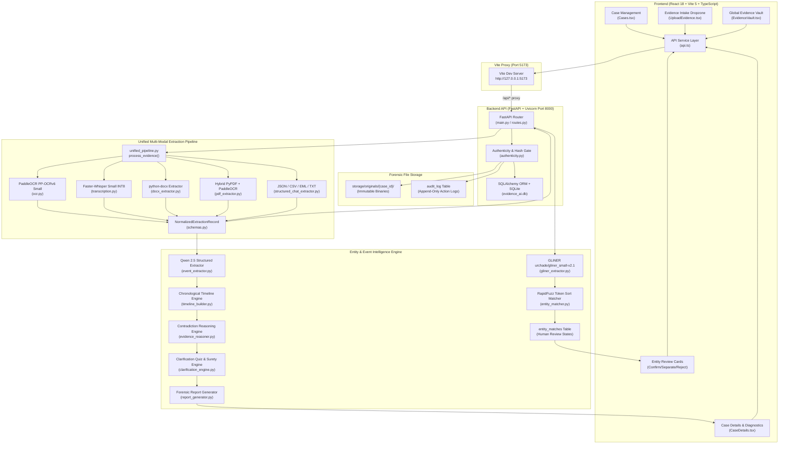

# Evidence AI — Complete Project Architecture

**System:** Evidence AI — Forensic Digital Evidence Intake, Extraction & Entity Intelligence Platform  
**Target Environment:** Windows 11 / NVIDIA RTX 4050 (6 GB VRAM) / Local CPU/GPU Acceleration  
**Repository Path:** `C:\project`  
**Active Branch:** `feature/extraction-integration`  
**Audit Date:** November 14, 2026  

---

## 1. System Overview

Evidence AI is a privacy-first, local-execution forensic intelligence platform designed for civil society advocates, forensic examiners, and legal teams to intake, verify, extract, and connect multi-modal digital evidence without transmitting sensitive data to third-party cloud APIs.

### Core Architectural Pillars
1. **Forensic Integrity:** Evidence files are preserved bit-for-bit in an immutable originals directory (`storage/originals/{case_id}/{uuid}{ext}`) with SHA-256 fingerprinting computed at intake and recorded in an append-only audit log table.
2. **Local AI/ML Execution:** All extraction engines (PaddleOCR, Faster-Whisper, GLiNER) run locally on the workstation. No third-party API keys or paid external services are utilized.
3. **Multi-Modal Intake Funnel:** Ingests screenshots/images, voice notes/audio intercepts, Word documents, text/scanned PDFs, JSON chat exports, CSV transaction records, EML emails, and raw TXT chat logs.
4. **Cross-Evidence Entity Disambiguation:** Named entities (Persons, Organizations, Locations, Dates, Identifiers) extracted via GLiNER are compared across disparate files using RapidFuzz token sorting. Matches are clustered as candidates for human investigator review—never merged automatically.
5. **Calm Human-Designed Interface:** A clean, responsive React 18 + TypeScript + Tailwind CSS application using a warm paper design palette, providing evidence tables, extraction diagnostics, and candidate review cards.

---

## 2. High-Level Architecture Diagram



---

## 3. Directory Structure & File Catalog

```
c:\project\
│
├── .gitignore                      # Configures git exclusion for .venv, storage, caches, DBs
├── app.py                          # Streamlit prototype viewer (legacy testing harness)
├── evidence_ai.db                  # SQLite database storing cases, evidence, audits, entities
├── package.json                    # Workspace metadata
├── package-lock.json               # Root lockfile
├── requirements.txt                # Pinned backend Python dependencies
├── test_intake.py                  # Initial intake testing script
├── test_validation.py              # Initial schema validation script
│
├── backend/                        # FastAPI application core
│   ├── __init__.py
│   ├── authenticity.py             # MIME, magic header, and SHA-256 authenticity gate
│   ├── db.py                       # SQLAlchemy engine, session maker, init_db()
│   ├── main.py                     # FastAPI application entry point, CORS, startup hooks
│   ├── models.py                   # SQLAlchemy tables & Pydantic response models
│   └── routes.py                   # 15 REST endpoints for cases, evidence, OCR, entities
│
├── frontend/                       # React 18 + Vite 5 SPA
│   ├── index.html                  # HTML template
│   ├── package.json                # Frontend dependencies (React, Tailwind, Lucide, Router)
│   ├── package-lock.json
│   ├── postcss.config.js           # PostCSS configuration for Tailwind
│   ├── tailwind.config.js          # Warm paper palette design configuration
│   ├── tsconfig.json               # TypeScript compiler options
│   ├── vite.config.js              # Vite server & /api reverse proxy configuration
│   └── src/
│       ├── App.tsx                 # React Router routing table & AppProvider wrapper
│       ├── index.css               # Global Tailwind CSS directives & typography rules
│       ├── main.tsx                # React DOM render entry point
│       ├── assets/                 # SVGs and UI branding icons
│       ├── components/
│       │   ├── common/
│       │   │   ├── Button.tsx      # Reusable button component with variant support
│       │   │   ├── ConfirmDialog.tsx # Modal dialog for confirming destructive actions
│       │   │   └── Modal.tsx       # Standard overlay modal dialog
│       │   └── layout/
│       │       ├── AppLayout.tsx   # Shell layout wrapping Sidebar and TopNavbar
│       │       ├── Sidebar.tsx     # Primary navigation links (Cases, Vault, Settings)
│       │       └── TopNavbar.tsx   # Top navigation header with status indicators
│       ├── context/
│       │   └── AppContext.tsx      # React Context managing active case, evidence lists
│       ├── pages/
│       │   ├── CaseDetails.tsx     # Case view: Evidence table, extraction modal, entity review
│       │   ├── Cases.tsx           # Case list, case creation modal, case metrics
│       │   ├── EvidenceVault.tsx   # Cross-case evidence browser with SHA-256 search
│       │   ├── Settings.tsx        # System diagnostic settings & local model statuses
│       │   └── UploadEvidence.tsx  # Multi-file drag-and-drop intake dropzone with notes
│       ├── services/
│       │   └── api.ts              # Fetch-based REST API service connecting to backend
│       └── types/
│           └── index.ts            # TypeScript interfaces for Case, Evidence, CandidateMatch
│
├── models_cache/                   # Persistent local directory for model weights
│   ├── huggingface/                # Cached urchade/gliner_small-v2.1 weights
│   ├── paddlex/                    # Cached PP-OCRv6_small_det & PP-OCRv6_small_rec models
│   └── whisper/                    # Cached Systran/faster-whisper-small model.bin
│
├── src/                            # Core Intelligence & Extraction Engines
│   ├── __init__.py
│   ├── extraction/                 # Modality-specific extractors
│   │   ├── __init__.py
│   │   ├── docx_extractor.py       # Extracts paragraphs, tables, and properties via python-docx
│   │   ├── ocr.py                  # PP-OCRv6 small singleton engine for screenshot OCR
│   │   ├── pdf_extractor.py        # Hybrid PDF parser: pypdf text + pypdfium2/OCR fallback
│   │   ├── schemas.py              # Pydantic models for segments and normalized extraction
│   │   ├── structured_chat_extractor.py # Parsers for JSON, CSV, EML emails, and TXT chats
│   │   ├── text_extractor.py       # Legacy document text extractor
│   │   ├── transcription.py        # Faster-Whisper Small INT8 singleton transcriber
│   │   └── unified_pipeline.py     # Unified process_evidence() router across all formats
│   ├── intelligence/               # Entity extraction, event intelligence & timeline
│   │   ├── __init__.py
│   │   ├── clarification_engine.py # Interactive clarification quiz & ordinal surety (0-4)
│   │   ├── entity_matcher.py       # RapidFuzz candidate clustering & human review logic
│   │   ├── event_extractor.py      # Qwen 2.5 structured event extractor & modality analyzer
│   │   ├── evidence_reasoner.py    # Cross-evidence contradiction & discrepancy reasoner
│   │   ├── gliner_extractor.py     # GLiNER urchade/gliner_small-v2.1 extractor + regex
│   │   └── timeline_builder.py     # Deterministic chronological timeline builder
│   │
│   └── reporting/                  # Forensic reporting
│       ├── __init__.py
│       └── report_generator.py     # Forensic incident report synthesis (JSON & printable HTML)
│
├── storage/                        # Persistent file storage
│   └── originals/                  # Untouched original evidence files grouped by case ID
│
└── tests/                          # Automated verification suites
    ├── benchmark_ocr.py            # Comparative benchmark between PP-OCRv6 Medium/Small/Tiny
    ├── test_e2e_live.py            # End-to-end upload test through Vite reverse proxy
    ├── test_entity_matching_regression.py # Regression test suite for GLiNER and RapidFuzz
    ├── test_full_platform_integration.py # In-process PyTest suite covering all models
    ├── test_live_api_e2e.py        # Live HTTP test suite testing all 7 modalities & review
    ├── test_pipeline.py            # Isolated unit test for OCR & Faster-Whisper
    ├── test_qwen_event_extraction.py # Tests for event extraction, timeline, quiz, & report
    └── test_ui_upload_verification.py # Mimics exact FormData upload from React dropzone
```

---

## 4. Entry Points

### 1. Backend Server
- **File:** `backend/main.py`
- **Execution Command:**  
  `c:\project\.venv\Scripts\python.exe -m uvicorn backend.main:app --host 127.0.0.1 --port 8000`
- **Key Initialization Logic:**  
  1. Calls `import ctranslate2` before any other imports to prevent the Windows OpenMP symbol collision.  
  2. Sets local model cache paths (`models_cache/paddlex`, `models_cache/paddle`, `models_cache/huggingface`).  
  3. Executes `init_db()` creating `cases`, `evidence`, `audit_log`, and `entity_matches` tables in `evidence_ai.db`.  
  4. Mounts CORS middleware allowing `http://localhost:5173` and `http://127.0.0.1:5173`.  
  5. Includes REST routes under the `/api` prefix.

### 2. Frontend Development Server
- **Directory:** `frontend/`
- **Entry File:** `frontend/src/main.tsx` (loads `App.tsx` and renders to `#root` in `index.html`)
- **Execution Command:**  
  `cd c:\project\frontend && npm.cmd run dev -- --host 127.0.0.1 --port 5173`
- **Proxy Configuration:**  
  `frontend/vite.config.js` proxies any request starting with `/api` to `http://127.0.0.1:8000`.
